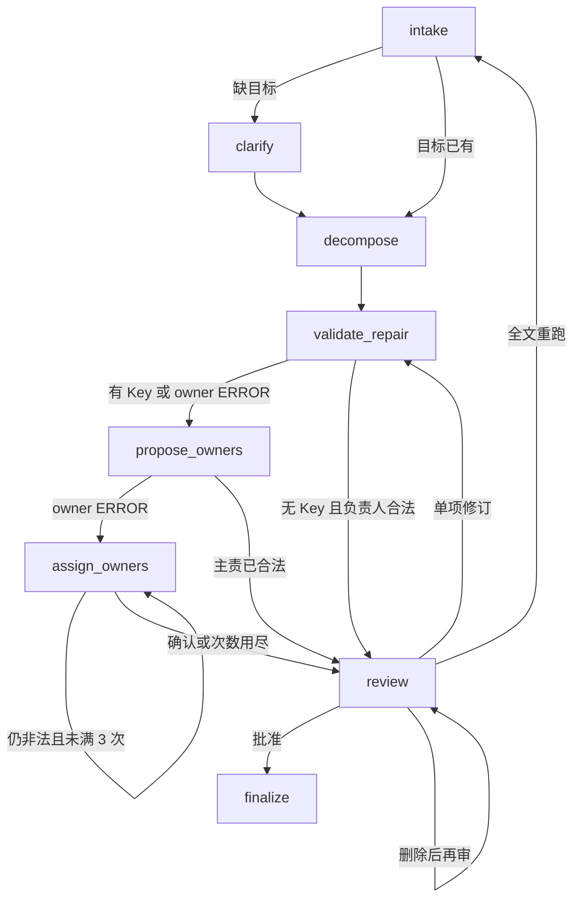
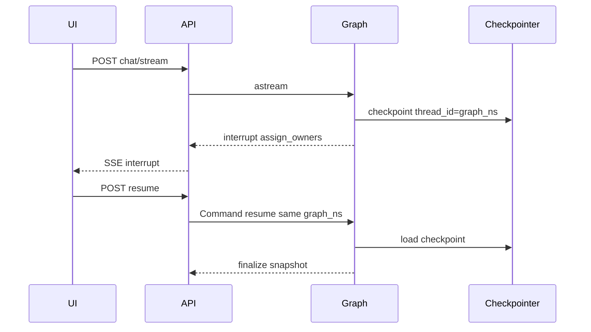

# SpecOps Agent

生产向的 agent 参考实现：把中文会议对话变成带原文证据的任务清单，并拆主责/次责。

无法从原文确认或负责人非法时进入人工分配，而不是用规则填写「待指定」。
交付前保留澄清、校验、人工审核，并支持 Markdown / JSON 导出。

## 架构





- SSE：节点进度和 interrupt，前端步进条只认 `running | done | skipped | waiting`。
- SQLite 快照：给人看的任务清单、审核状态、`token_in` / `token_out` / `latency_ms`。
- Checkpoint：LangGraph 图游标。`graph_ns` 跨 HITL 不变，否则续不上。

## 核心能力

- **主/次责拆分**：一人主责；多人时按「负责/统筹」与「配合/协助」拆主次。
- **证据可追溯**：每个任务保留原文证据，`evidence_quote` 必须是输入子串。
- **状态图编排**：LangGraph 串联解析、澄清、拆解、校验修复、负责人建议、负责人分配和审核。
- **Human-in-the-Loop**：缺目标澄清、非法/缺失负责人分配、最终审核，均用 `interrupt` 恢复。
- **链路可视化**：SSE `progress.status` 为 `running | done | skipped | waiting`，前端步进条高亮当前节点。
- **可选 LLM**：DeepSeek 结构化输出；无 API Key 时走确定性规则路径。负责人建议由模型提出、人工确认后才写入（建议不等于写入）。
- **可靠执行**：请求幂等、线程忙碌保护、SQLite 快照和 LangGraph checkpoint。429/5xx 有限次重试，超时不重试。分块抽取并发不超过 `LLM_MAX_CONCURRENCY`。

## 工作流

```text
intake (DeepSeek | rules)
  → clarify? (HITL，缺会议目标)
  → decompose (DeepSeek | rules)
  → validate_repair (LLM 工具循环有上限 | 规则修复 ≤ 2，不修复负责人)
  → propose_owners? (有 Key 时始终生成建议；有 owner ERROR 或无 Key 失败则为空)
  → assign_owners? (HITL，任一 owner 校验 ERROR，含未消解的他/她；点选建议后须提交)
  → review? (HITL，批准 / 单项修订 / 删除 / 全文重跑；主责已合法时可点选次责建议)
  → finalize (Markdown / JSON)
```

`assign_owners` 最多 3 次。仍非法则携带 ERROR 进入 review，由人工显式批准；`finalize` 不再因 owner ERROR 拦截。
模型给出的负责人建议只出现在分配面板或审核面板；`confidence` 映射为低/中/高仅供参考，不自动写入主责/次责。没有协作信号时不出次责建议。JSON 导出剥离 `owner_suggestions`。

一次运行的 token 与墙钟累加在快照里，并随 SSE `result` 返回。日志是一行一条 JSON，带同一个 `request_id`。

## 技术栈

| 部分 | 技术 |
| --- | --- |
| 前端 | Vue 3、TypeScript、Vite |
| API | FastAPI、Pydantic、Uvicorn |
| Agent | LangGraph、DeepSeek API、规则回退 |
| 存储 | aiosqlite、LangGraph SQLite Checkpointer |
| 测试 | Pytest、pytest-asyncio、respx、Ruff、Vitest；Playwright 仅本地 |
| 工程化 | uv.lock、Docker Compose、GitHub Actions |

## 运行要求

- Python 3.11+
- [uv](https://docs.astral.sh/uv/)
- Node.js 22+ 与 npm
- 可选：Docker Desktop / Docker Engine + Compose
- 可选：DeepSeek API Key

## 快速开始

### 本地运行

后端：

```powershell
cd backend
uv sync --extra dev
copy .env.example .env
uv run uvicorn app.main:app --reload --port 8001
```

前端（新终端）：

```powershell
cd frontend
npm install
npm run dev
```

打开：

- Web UI：<http://localhost:5173>
- API：<http://localhost:8001>
- 健康检查：<http://localhost:8001/health>

### Docker Compose

```powershell
docker compose up --build
```

Compose 默认 `LLM_PROVIDER=none`，没有 API Key 时走规则路径。

## 环境配置

将 [`backend/.env.example`](backend/.env.example) 复制为 `backend/.env`：

```dotenv
LLM_PROVIDER=deepseek
DEEPSEEK_API_KEY=
DEEPSEEK_BASE_URL=https://api.deepseek.com
DEEPSEEK_MODEL=deepseek-v4-flash
LLM_TIMEOUT_SECONDS=30
LLM_MAX_RETRIES=2
LLM_RETRY_BUDGET_SECONDS=8
LLM_MAX_CONCURRENCY=3
CORS_ORIGINS=http://localhost:5173
DATABASE_PATH=./specops.db
CHECKPOINT_PATH=./specops_checkpoints.db
```

没有 DeepSeek Key 时，将 `LLM_PROVIDER` 设为 `none`。不要提交 `.env`、API Key、数据库或运行日志。

`LLM_MAX_RETRIES` 只覆盖 429、5xx 和传输错误，超时不重试。`chat_json` 另有一轮 schema 重试，单次逻辑抽取的 HTTP 上限是 `2 * (1 + LLM_MAX_RETRIES)`。`LLM_RETRY_BUDGET_SECONDS` 是这一次调用里退避睡眠的总和上限。

## 快速体验

前端内置三份示例输入（按钮为示例1 / 示例2 / 示例3）：

- **示例1**：新产品上线推进，陈述句纪要，一人多任务，含主/次责与周期执行。
- **示例2**：预发事故复盘，夹杂非任务背景句，再落到可执行项。
- **示例3**：需求评审待办，出现「交给她负责」，原文无法消解指代，进入人工分配。

操作流程：

1. 点击示例按钮载入对话，或粘贴自己的文本。
2. 点击「开始分析」，在顶部链路条查看当前节点。
3. 缺会议目标时补充澄清；缺/非法负责人时在分配面板选择主责/次责。
4. 审核阶段批准，按条目修订，或删除非任务（全局序号 / 删除按钮）；也可全文重跑。
5. 导出 Markdown 或 JSON。

样例在 [`frontend/public/samples/`](frontend/public/samples/)。

## API

| 方法 | 路径 | 说明 |
| --- | --- | --- |
| `GET` | `/health` | 服务与 LLM Provider 状态 |
| `POST` | `/api/v1/chat/stream` | 创建任务规划并返回 SSE 事件流 |
| `POST` | `/api/v1/runs/{run_id}/resume` | 分配负责人、修订或批准 |
| `GET` | `/api/v1/threads/{thread_id}` | 获取线程快照 |
| `GET` | `/api/v1/threads/{thread_id}/export?format=md\|json` | 导出结果 |

SSE `progress` 带 `status`: `running` / `done` / `skipped` / `waiting`。
`interrupt.type` 为 `clarify` | `assign_owners` | `review`。
`result` 里的快照含 `token_in`、`token_out`、`latency_ms`（无 Key 时为 0）。

Resume 分配示例：`{"interrupt_type":"assign_owners","assignments":[{"item_id":"...","primary_owner":"张伟","secondary_owners":["李娜"]}]}`。
`interrupt_type` 若与当前暂停类型不符则 400。

## 测试与评测

后端：

```powershell
cd backend
uv run ruff check app tests evals
uv run pytest
```

冻结评测集（规则路径，必须 `LLM_PROVIDER=none`；若检测到 LLM Key 会直接失败）：

```powershell
cd backend
uv run python -m evals.generate_cases
uv run pytest tests/test_eval_golden.py -q
```

先 `generate_cases` 再把 `evals/golden/*.json` 提交进仓库。门槛写死：任务召回 ≥ 0.9，主责 exact ≥ 0.8，次责 set 相等 ≥ 0.8，HITL 触发一致 = 100%。

Hard 集的 CI 回放读冻结 cassette，下限在 `evals/hard_expected.json`，重录不会改这两处。规则路径对复姓和弱动词只上报、不把漏检写成失败；`llm` / `llm_only` 回放有硬下限。真 API 的 token、成本和语义分在 [`backend/evals/report.md`](backend/evals/report.md)，由下面的命令生成，不进 pytest：

```powershell
cd backend
uv run python -m evals.report
```

前端：

```powershell
cd frontend
npm ci
npm test
npm run build
```

本地端到端（不进 CI）：`npm run test:e2e`。它会拉起无 Key 的后端和 Vite，走示例3 的分析、分配、审核和导出。首次需要 `npx playwright install chromium`。

GitHub Actions 使用 Python 3.12、uv、Node.js 22 和 `LLM_PROVIDER=none`。

## 项目结构

```text
specops-agent/
├── .github/workflows/ci.yml
├── backend/
│   ├── app/
│   │   ├── agent/          # LangGraph、节点、工具、Prompt 与 SSE
│   │   ├── api/            # Chat、审核与线程 API
│   │   ├── domain/         # 数据模型、抽取和校验
│   │   ├── llm/            # DeepSeek 客户端
│   │   └── memory/         # 快照、幂等与 checkpoint
│   ├── evals/              # 生成器、runner、score、冻结 golden、report
│   ├── tests/
│   ├── pyproject.toml
│   └── uv.lock
├── frontend/
│   ├── public/samples/
│   └── src/
├── docs/adr/
├── docs/INTERVIEW.md
├── docker-compose.yml
└── README.md
```

## Production Hardening Roadmap（未实现）

这些是上线前要补的项，当前仓库没有对应实现：

- 鉴权，以及按租户隔离线程、快照和 checkpoint。
- 入口限流（按租户 / API Key），与模型调用的并发上限分开。
- 密钥托管（Vault 或云 KMS），进程只拿短期凭证。
- 监控告警：错误率、SSE 挂起、token 与延迟、checkpoint 写入失败。
- 部署拓扑：后端 API、前端静态资源、Nginx、对象存储（导出文件）。SQLite 换成托管数据库。
- 灰度与回滚：按 prompt 版本切流量，坏版本回到上一版 checkpoint 兼容的图。
- 外部工单同步（Jira / 飞书）：批准之后才写，并且可回滚。代码里没有同步字段，也没有假适配器。

## 安全说明

- `backend/.env` 仅供本地使用，已被 `.gitignore` 排除。
- API Key 一旦进入日志、提交历史或公开渠道，应立即在服务商控制台轮换。
- 上传前请检查 `.env`、`*.db`、`*.log`、IDE 配置和构建产物未被追踪。
